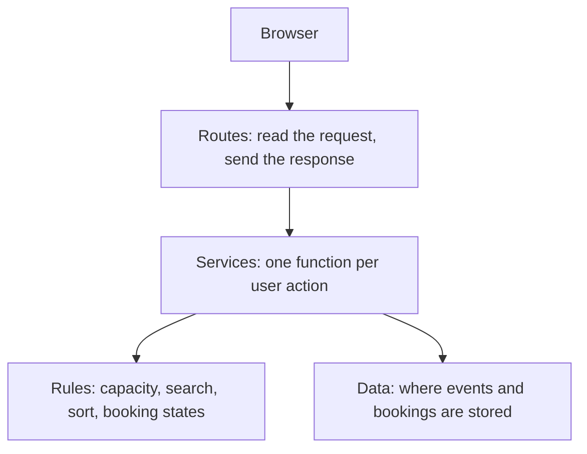
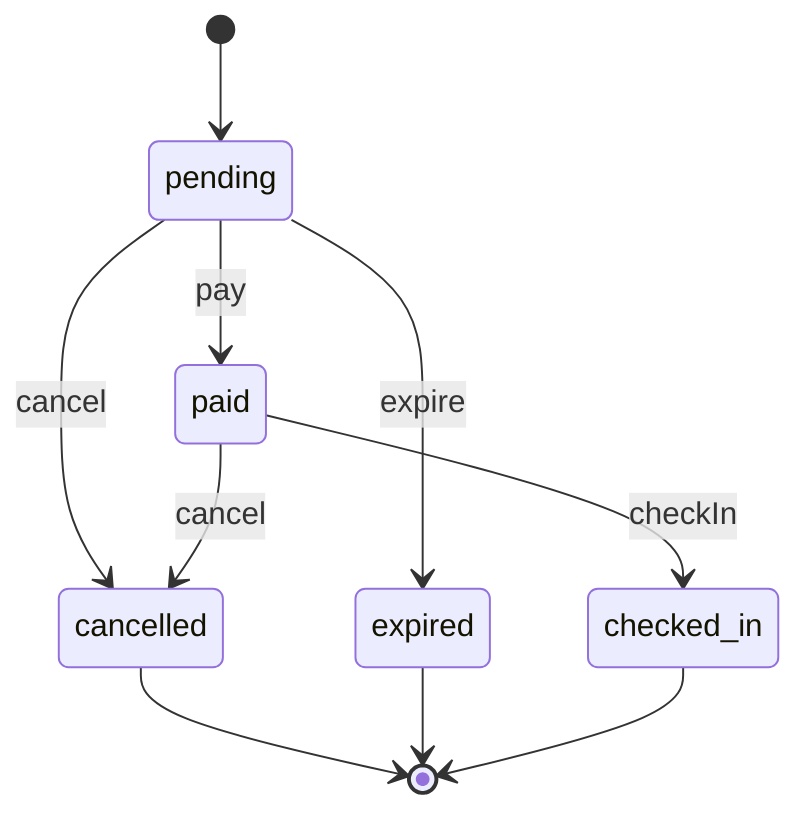

# Architecture

## Layers
Each layer only talks to the one below it.

Where things are today:
- Routes: `src/server.js` (only `/health` and static files so far)
- Services: arrive in Build 4 with the REST API
- Rules: `src/booking-system.js`, `src/event.js`, `src/search.js`, `src/sort.js`, `src/booking-state.js`
- Data: in-memory `Map`s for now, SQLite in Build 5

## Booking life cycle

Any action not drawn here is refused with `INVALID_TRANSITION`.